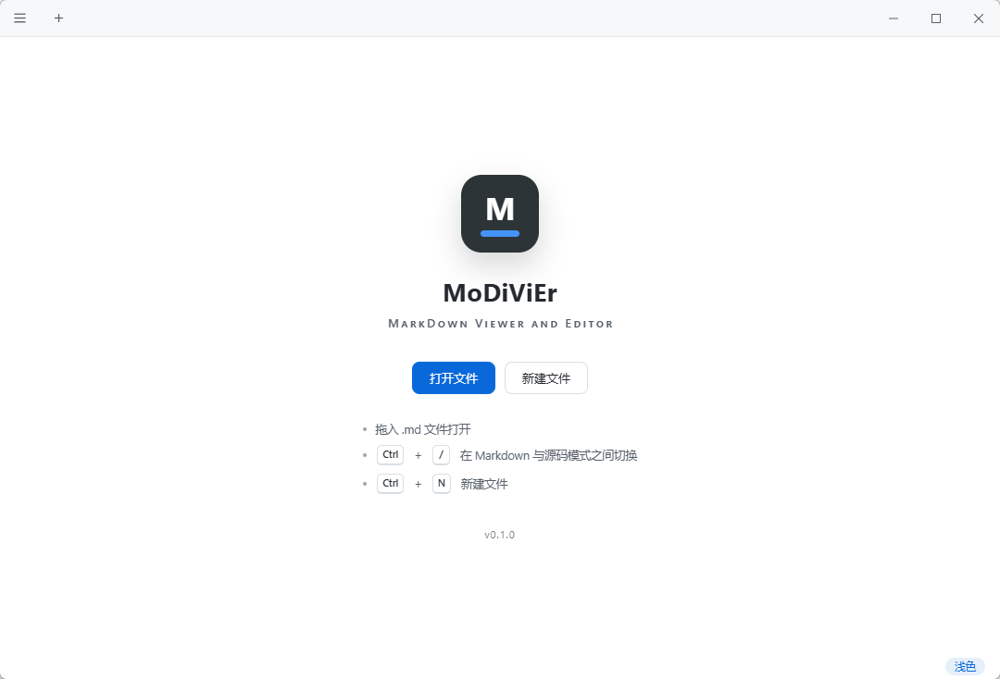

<div align="center">


# MoDiViEr

**MarkDown Viewer and Editor —— 参考 Typora 的轻量 Markdown 阅读与编辑器**

[](https://github.com/lythu95/modivier/releases)
[](./LICENSE)
[](https://v2.tauri.app)
[](https://www.microsoft.com/windows)
[](https://www.apple.com/macos)
[](../../releases)

**简体中文** ｜ [繁體中文](./README_ZH-TW.md) ｜ [English](./README_EN.md) ｜ [日本語](./README_JA.md)

</div>

基于 [Tauri 2](https://v2.tauri.app) 构建，主打"够轻、够快、够简单"：冷启动约 0.5 秒、安装包约 5MB、内存占用约 80MB，只保留阅读与最基础的编辑能力。

<div align="center">
  <table><tr>
    <td align="center"><br/><sub>主页</sub></td>
    <td align="center"><br/><sub>编辑器</sub></td>
  </tr></table>
</div>

## 为什么做这个

- Typora 开始收费；
- VSCode 打开单个 `.md` 文件太重，启动慢，且大量功能在这个场景下用不上；
- 目标：像记事本一样简单直接的 Markdown 工具——**看和改**，其他都不要（无打印、无云同步、无插件系统）。

## 功能

- **所见即所得编辑**（Vditor 即时渲染模式，行为最接近 Typora：光标所在块显示源码，其余渲染成稿）
- **源码模式**（CodeMirror 6，`Ctrl+/` 与所见即所得双向切换，内容自动同步）
- **大纲视图**（左侧标题树，层级折叠/展开，点击跳转；默认展开，可收起为窄条或 `Ctrl+Shift+O` 切换）
- **多标签页**（拖入文件、`Ctrl+O`、`Ctrl+N`、中键/Ctrl+W 关闭、`Ctrl+Tab` 循环、`Ctrl+1..9` 直达）
- **状态栏**（行列位置、选中字数、全文字数；右下角 Markdown/Source 与 Light/Dark 快速切换）
- **多语言**（简体中文 / 繁體中文 / English / 日本語，菜单内切换，跟随系统初始化）
- **本地图片**：自动解析 Markdown 内的相对路径图片并在编辑器中显示
- **浅色 / 深色主题**（跟随系统初始化，手动切换后记忆）
- **VSCode 式全宽滚动**：内容居中排版，但整个内容区任意位置滚轮/翻页都作用于文档
- **编码兼容**：读取 UTF-8 / UTF-8 BOM / GBK；保存统一写出 UTF-8（无 BOM）
- **启动性能**：编辑器大模块（Vditor/CodeMirror）按需分包、窗口先行显示，vditor 未用渲染器（mathjax/graphviz/echarts 等）已从打包裁剪；冷启动约 0.5~0.7s，安装包约 5MB
- **单实例 + 文件关联**：双击 `.md` / 右键“打开方式”会聚焦已运行窗口并开新标签。Windows：安装包自动注册 `.md` / `.markdown` 关联，便携单文件可在菜单里点“关联 .md 文件”一键注册（当前用户级、免管理员）；macOS：应用拖入“应用程序”后，在 Finder“打开方式”中选择即可，双击直达；Linux：deb / rpm 包内置 MIME 关联
- **窗口状态记忆**：尺寸、位置、最大化状态自动保存，下次启动恢复
- 窗口拖拽文件直接打开；未保存关闭标签/窗口时有确认提示（编辑器加载时的规范化不计为修改，原样关闭不打扰）

### 快捷键

| 快捷键 | 功能 |
| --- | --- |
| `Ctrl+O` | 打开文件 |
| `Ctrl+N` | 新建文件 |
| `Ctrl+S` / `Ctrl+Shift+S` | 保存 / 另存为 |
| `Ctrl+/` | 切换 Markdown / 源码模式 |
| `Ctrl+Shift+O` | 大纲视图开合 |
| `Ctrl+W` | 关闭当前标签页 |
| `Ctrl+Tab` / `Ctrl+Shift+Tab` | 下一个 / 上一个标签页 |
| `Ctrl+1` … `Ctrl+9` | 切换到第 n 个标签页 |

## 下载与安装

各平台安装包均可从 [Releases](../../releases) 页面获取。

**Windows**：下载 `modivier_x.y.z_x64-setup.exe`（约 5MB 的 NSIS 安装包），安装后自动注册 `.md` / `.markdown` 文件关联，资源管理器里双击即可打开；免安装可直接下载 `modivier_x.y.z_x64_portable.exe` 便携单文件，在菜单里点“关联 .md 文件”注册到系统“打开方式”列表（当前用户级、免管理员）。Windows 10 / 11 自带 WebView2，无需额外安装运行时。

**macOS**（Intel / Apple Silicon 通用）：下载 `modivier_x.y.z_universal.dmg`，把 MoDiViEr.app 拖入“应用程序”并启动一次；之后在 `.md` 文件上右键 → 打开方式 选择 MoDiViEr，或在“显示简介”（⌘I）→ 打开方式 → “全部更改…”设为默认，双击即可打开（已运行时在现有窗口开新标签）。安装包未签名：首次打开若被 Gatekeeper 拦截，右键 → 打开 即可。

**Linux**：`npm run tauri build` 产出 deb / rpm 包（已注册 Markdown MIME 关联）；如需 AppImage 可用 `npx tauri build --bundles appimage` 追加。

## 开发

### 环境要求

- [Node.js](https://nodejs.org/) ≥ 18
- [Rust](https://www.rust-lang.org/) stable（Windows 需 MSVC 工具链）
- Windows 10/11（自带 WebView2）、macOS 10.13+，或 Linux（需 WebKitGTK 4.1 等依赖）

### 常用命令

```bash
npm install         # 安装依赖（postinstall 会把 vditor 静态资源复制到 public/vditor）
npm run tauri dev   # 开发调试
npm run tauri build # 打包到 src-tauri/target/release/bundle/：Windows NSIS、macOS DMG、Linux deb/rpm（按当前系统）
```

`npm run dev` 可以脱离 Tauri 在纯浏览器里调试 UI（文件相关功能自动降级禁用）。

### 重新生成图标

```powershell
powershell -NoProfile -ExecutionPolicy Bypass -File scripts/make-icon.ps1
powershell -NoProfile -ExecutionPolicy Bypass -File scripts/make-nsis-header.ps1
npx tauri icon src-tauri/icons-src/app-icon.png
```

## 技术选型

| 层 | 选择 | 理由 |
| --- | --- | --- |
| 外壳 | Tauri 2 | 系统 WebView（WebView2 / WKWebView / WebKitGTK），包体积与内存远小于 Electron；Rust 侧仅做文件 IO，面攻击小 |
| 所见即所得 | [Vditor](https://github.com/Vanessa219/vditor)（IR 模式） | 即时渲染模式专为复刻 Typora 交互设计，开箱支持表格/代码块/数学/流程图（资源已本地化，离线可用） |
| 源码模式 | CodeMirror 6 | 现代轻量的代码编辑器，Markdown 语法高亮、查找 |
| 前端 | 原生 TypeScript + Vite | 界面只有一个标题栏 + 标签条 + 编辑区，不引入框架 |

几个实现要点：

- **文件读写走自定义 Rust 命令**（`read_file`/`write_file`），未启用 fs 插件，前端拿不到任意文件系统权限；读取时按 UTF-8 → GBK 顺序探测编码。
- **本地图片**通过 Tauri asset 协议（`convertFileSrc`）+ MutationObserver 将相对路径改写为绝对地址，编辑的源码文本保持原样不受污染。
- **Vditor 资源本地化**：`postinstall` 将 `node_modules/vditor/dist` 复制到 `public/vditor`，其懒加载的 highlight/katex/mermaid 全部走本地，无网络依赖。
- **Vditor 初始化是异步的**（需先加载 Lute），实例方法在 `after` 回调前不可用，代码中统一做了就绪守卫——这是接入时踩过的坑。
- **跨平台打包**：打包目标按平台拆分在 `tauri.{windows,macos,linux}.conf.json`，Tauri 按当前系统自动合并；macOS 双击文件经 Apple Event（`RunEvent::Opened`）投递而非 argv，Rust 侧接收后转发给前端，早于 webview 就绪时由启动参数缓存兜底。

## 目录结构

```
├─ scripts/            # vditor 资源复制、图标生成脚本
├─ src/                # 前端（原生 TS）
│  ├─ lib/tauri.ts     # Tauri API 封装（含浏览器降级）
│  ├─ ui/              # 标题栏 / 标签条 / 菜单 / 对话框 / 状态栏
│  ├─ state.ts         # 标签页状态
│  ├─ editors.ts       # Vditor + CodeMirror 双编辑器封装
│  ├─ i18n.ts          # 多语言字典（简中/繁中/英/日）
│  ├─ files.ts         # 打开/保存/关闭流程
│  ├─ images.ts        # 相对路径图片解析
│  └─ main.ts          # 入口：快捷键、拖放、单实例、关闭确认
└─ src-tauri/          # Rust 后端 + 平台打包配置（tauri.{windows,macos,linux}.conf.json）
```

## 明确不做的功能

打印、导出 PDF、云同步、图片上传、插件系统、Vim 模式……按"记事本哲学"，需要时再议。

## 许可证

本项目基于 [MIT](./LICENSE) 协议开源。

## 反馈

使用中遇到问题或有建议，欢迎在 [GitHub Issues](https://github.com/lythu95/modivier/issues) 或 [Gitee Issues](https://gitee.com/lythu/modivier/issues) 中提出。
