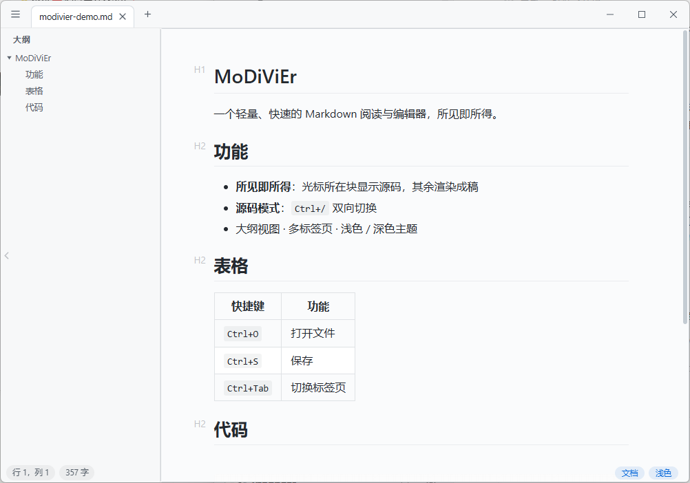

<div align="center">


# MoDiViEr

**MarkDown Viewer and Editor —— 參考 Typora 的輕量 Markdown 閱讀與編輯器**

[](https://github.com/lythu95/modivier/releases)
[](./LICENSE)
[](https://v2.tauri.app)
[](https://www.microsoft.com/windows)
[](https://www.apple.com/macos)
[](../../releases)

[简体中文](./README.md) ｜ **繁體中文** ｜ [English](./README_EN.md) ｜ [日本語](./README_JA.md)

</div>

以 [Tauri 2](https://v2.tauri.app) 建置，主打「夠輕、夠快、夠簡單」：冷啟動約 0.5 秒、安裝包約 5MB、記憶體占用約 80MB，只保留閱讀與最基礎的編輯能力。

<div align="center">
  
</div>

## 為什麼做這個

- Typora 開始收費；
- 用 VSCode 開啟單一 `.md` 檔案太重，啟動慢，且大量功能在這個情境下用不上；
- 目標：像記事本一樣簡單直接的 Markdown 工具——**看和改**，其他都不要（無列印、無雲端同步、無外掛系統）。

## 功能

- **所見即所得編輯**（Vditor 即時渲染模式，行為最接近 Typora：游標所在區塊顯示原始碼，其餘渲染成稿）
- **原始碼模式**（CodeMirror 6，`Ctrl+/` 與所見即所得雙向切換，內容自動同步）
- **大綱檢視**（左側標題樹，階層摺疊/展開，點擊跳轉；預設展開，可收合為窄條或 `Ctrl+Shift+O` 切換）
- **多分頁**（拖入檔案、`Ctrl+O`、`Ctrl+N`、中鍵/Ctrl+W 關閉、`Ctrl+Tab` 循環、`Ctrl+1..9` 直達）
- **狀態列**（行列位置、選取字數、全文字數；右下角 Markdown/Source 與 Light/Dark 快速切換）
- **多國語言**（簡體中文 / 繁體中文 / English / 日本語，選單內切換，跟隨系統初始化）
- **本機圖片**：自動解析 Markdown 內的相對路徑圖片並在編輯器中顯示
- **淺色 / 深色主題**（跟隨系統初始化，手動切換後記憶）
- **VSCode 式全寬捲動**：內容置中排版，但整個內容區任意位置滾輪/翻頁都作用於文件
- **編碼相容**：讀取 UTF-8 / UTF-8 BOM / GBK；儲存統一寫出 UTF-8（無 BOM）
- **啟動效能**：編輯器大模組（Vditor/CodeMirror）按需分包、視窗先行顯示，vditor 未用渲染器（mathjax/graphviz/echarts 等）已從打包裁剪；冷啟動約 0.5~0.7s，安裝包約 5MB
- **單一實例 + 檔案關聯**：雙擊 `.md` / 右鍵「開啟方式」會聚焦已執行視窗並開新分頁。Windows：安裝包自動註冊 `.md` / `.markdown` 關聯，便攜單檔可在選單裡點「關聯 .md 檔案」一鍵註冊（目前使用者層級、免系統管理員）；macOS：將應用程式拖入「應用程式」後，於 Finder「開啟方式」中選擇即可，雙擊直達；Linux：deb / rpm 包內建 MIME 關聯
- **視窗狀態記憶**：尺寸、位置、最大化狀態自動保存，下次啟動還原
- 視窗拖曳檔案直接開啟；未儲存就關閉分頁/視窗時有確認提示（編輯器載入時的規範化不計為修改，原樣關閉不打擾）

### 快捷鍵

| 快捷鍵 | 功能 |
| --- | --- |
| `Ctrl+O` | 開啟檔案 |
| `Ctrl+N` | 新增檔案 |
| `Ctrl+S` / `Ctrl+Shift+S` | 儲存 / 另存為 |
| `Ctrl+/` | 切換 Markdown / 原始碼模式 |
| `Ctrl+Shift+O` | 大綱檢視開合 |
| `Ctrl+W` | 關閉目前分頁 |
| `Ctrl+Tab` / `Ctrl+Shift+Tab` | 下一個 / 上一個分頁 |
| `Ctrl+1` … `Ctrl+9` | 切換到第 n 個分頁 |

## 下載與安裝

各平台安裝包均可從 [Releases](../../releases) 頁面取得。

**Windows**：下載 `MoDiViEr_x.y.z_x64-setup.exe`（約 5MB 的 NSIS 安裝包），安裝後自動註冊 `.md` / `.markdown` 檔案關聯，在檔案總管雙擊即可開啟。`npm run tauri build` 的產物 `src-tauri/target/release/modivier.exe` 本身就是免安裝的便攜單檔，可在選單裡點「關聯 .md 檔案」註冊到系統「開啟方式」列表（目前使用者層級、免系統管理員）。Windows 10 / 11 內建 WebView2，無需額外安裝執行環境。

**macOS**（Apple Silicon）：下載 `MoDiViEr_x.y.z_aarch64.dmg`，將 MoDiViEr.app 拖入「應用程式」並啟動一次；之後在 `.md` 檔案上右鍵 → 開啟方式 選擇 MoDiViEr，或在「顯示簡介」（⌘I）→ 開啟方式 → 「全部更改…」設為預設，雙擊即可開啟（已執行時在現有視窗開新分頁）。安裝包未簽署：首次開啟若被 Gatekeeper 攔截，右鍵 → 開啟 即可。

**Linux**：`npm run tauri build` 產出 deb / rpm 包（已註冊 Markdown MIME 關聯）；如需 AppImage 可用 `npx tauri build --bundles appimage` 追加。

## 開發

### 環境需求

- [Node.js](https://nodejs.org/) ≥ 18
- [Rust](https://www.rust-lang.org/) stable（Windows 需 MSVC 工具鏈）
- Windows 10/11（內建 WebView2）、macOS 10.13+，或 Linux（需 WebKitGTK 4.1 等依賴）

### 常用指令

```bash
npm install         # 安裝依賴（postinstall 會把 vditor 靜態資源複製到 public/vditor）
npm run tauri dev   # 開發除錯
npm run tauri build # 打包到 src-tauri/target/release/bundle/：Windows NSIS、macOS DMG、Linux deb/rpm（按目前系統）
```

`npm run dev` 可以脫離 Tauri 在純瀏覽器裡除錯 UI（檔案相關功能自動降級停用）。

### 重新產生圖示

```powershell
powershell -NoProfile -ExecutionPolicy Bypass -File scripts/make-icon.ps1
powershell -NoProfile -ExecutionPolicy Bypass -File scripts/make-nsis-header.ps1
npx tauri icon src-tauri/icons-src/app-icon.png
```

## 技術選型

| 層 | 選擇 | 理由 |
| --- | --- | --- |
| 外殼 | Tauri 2 | 系統 WebView（WebView2 / WKWebView / WebKitGTK），安裝包體積與記憶體遠小於 Electron；Rust 側僅做檔案 IO，攻擊面小 |
| 所見即所得 | [Vditor](https://github.com/Vanessa219/vditor)（IR 模式） | 即時渲染模式專為重現 Typora 互動設計，開箱支援表格/程式碼區塊/數學/流程圖（資源已本地化，離線可用） |
| 原始碼模式 | CodeMirror 6 | 現代輕量的程式碼編輯器，Markdown 語法高亮、尋找 |
| 前端 | 原生 TypeScript + Vite | 介面只有一個標題列 + 分頁列 + 編輯區，不引入框架 |

幾個實作要點：

- **檔案讀寫走自訂 Rust 指令**（`read_file`/`write_file`），未啟用 fs 外掛，前端拿不到任意檔案系統權限；讀取時按 UTF-8 → GBK 順序偵測編碼。
- **本機圖片**透過 Tauri asset 協定（`convertFileSrc`）+ MutationObserver 將相對路徑改寫為絕對位址，編輯的原始碼文字保持原樣不受污染。
- **Vditor 資源本地化**：`postinstall` 將 `node_modules/vditor/dist` 複製到 `public/vditor`，其延遲載入的 highlight/katex/mermaid 全部走本機，無網路依賴。
- **Vditor 初始化是非同步的**（需先載入 Lute），實例方法在 `after` 回呼前不可用，程式碼中統一做了就緒檢查——這是接入時踩過的坑。
- **跨平台打包**：打包目標按平台拆分在 `tauri.{windows,macos,linux}.conf.json`，Tauri 按目前系統自動合併；macOS 雙擊檔案經 Apple Event（`RunEvent::Opened`）投遞而非 argv，Rust 側接收後轉發給前端，早於 webview 就緒時由啟動參數快取兜底。

## 目錄結構

```
├─ scripts/            # vditor 資源複製、圖示產生腳本
├─ src/                # 前端（原生 TS）
│  ├─ lib/tauri.ts     # Tauri API 封裝（含瀏覽器降級）
│  ├─ ui/              # 標題列 / 分頁列 / 選單 / 對話框 / 狀態列
│  ├─ state.ts         # 分頁狀態
│  ├─ editors.ts       # Vditor + CodeMirror 雙編輯器封裝
│  ├─ i18n.ts          # 多語言字典（簡中/繁中/英/日）
│  ├─ files.ts         # 開啟/儲存/關閉流程
│  ├─ images.ts        # 相對路徑圖片解析
│  └─ main.ts          # 進入點：快捷鍵、拖放、單一實例、關閉確認
└─ src-tauri/          # Rust 後端 + 平台打包配置（tauri.{windows,macos,linux}.conf.json）
```

## 明確不做的功能

列印、匯出 PDF、雲端同步、圖片上傳、外掛系統、Vim 模式……按「記事本哲學」，需要時再議。

## 授權條款

本專案基於 [MIT](./LICENSE) 授權條款開源。

## 回饋

使用中遇到問題或有建議，歡迎在 [GitHub Issues](https://github.com/lythu95/modivier/issues) 或 [Gitee Issues](https://gitee.com/lythu/modivier/issues) 提出。
